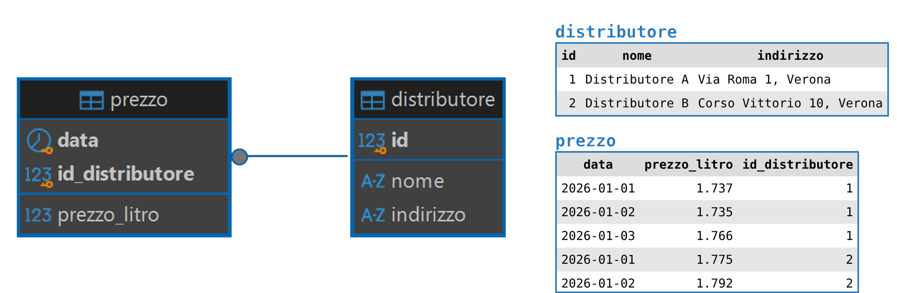
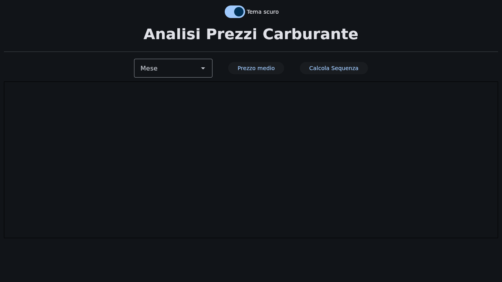
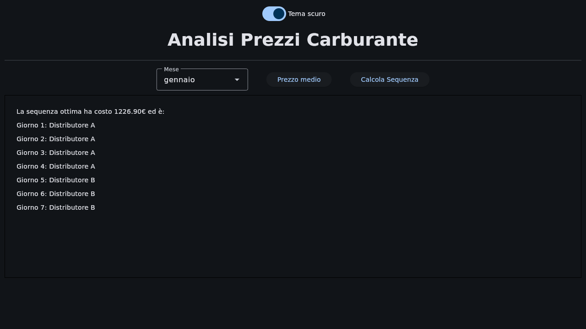

# Lab 08

#### Argomenti

- Utilizzo Pattern MVC
- Utilizzo dei Package
- Utilizzo di mysql-connector-python (suggerita v8.4.0)
- Utilizzo del Pattern DAO
- Utilizzo dell'Object Relational Mapping (ORM)
- Algoritmi di Ricorsione

---
> **❗ ATTENZIONE:** 
>  Ricordare di effettuare il **fork** del repository principale, quindi clonare su PyCharm il **repository personale** 
> (https://github.com/my-github-username/Lab08) e non quello principale.
> 
> In caso di dubbi consultare la guida caricata nel lab02: 
> https://github.com/Programmazione-Avanzata-2026-27/Lab02/blob/main/Guida.pdf
>
> Per il setup del database (XAMPP, DBeaver e creazione del database tramite il file `gestione_carburante.sql`) fare riferimento alla spiegazione del Lab06.

---

##  Prezzi del Carburante e Pianificazione dei Rifornimenti 
Progettare e realizzare un programma che gestisca le informazioni sui prezzi giornalieri del carburante di due 
distributori (Distributore A e Distributore B) e che consenta di pianificare nel modo più conveniente i rifornimenti giornalieri 
di un autotrasportatore, individuando, per un periodo di più giorni, la sequenza ottimale di distributori presso cui 
fare rifornimento, in modo da minimizzare il costo complessivo derivante dai prezzi del carburante e dagli spostamenti 
tra i due distributori.

Il programma utilizza il database fornito, denominato `gestione_carburante.sql`, che contiene due tabelle principali: 
- `distributore`: contiene le informazioni sui due distributori (Distributore A e Distributore B):
  - id
  - nome 
  - indirizzo 

- `prezzo`: contiene i prezzi giornalieri al litro dei due distributori per tutto l'anno 2026:
  - data 
  - prezzo_litro (il prezzo del carburante in €/litro)
  - id_distributore



L'applicazione, sviluppata in Python, deve permettere di:
- Interrogare la base dati per ottenere i **prezzi medi del carburante** nel corso di un **mese specifico** per 
entrambi i distributori; 
- Calcolare, attraverso un algoritmo di ottimizzazione ricorsiva, la sequenza di giornate più conveniente per 
pianificare i rifornimenti **nei primi 7 giorni di un mese selezionato**. 
L'obiettivo del programma è ottimizzare la pianificazione settimanale dei rifornimenti, decidendo giorno per giorno 
presso quale distributore fare rifornimento, in modo da ridurre al minimo il costo totale derivante dai prezzi del 
carburante e dagli spostamenti dell'autotrasportatore tra i due distributori.

##  Funzionalità Richieste
Nel progetto di base, l'interfaccia grafica (file `view.py` e `controller.py`) è già implementata con il seguente layout:

A partire dal layout proposto le funzionalità richieste sono le seguenti:

### (1) **Calcolo dei prezzi medi mensili (usando l'ORM)**
L'applicazione deve permettere all'utente di: 
- Selezionare un mese dell'anno (valore intero tra 1 e 12), tramite un Dropdown; 
- Premendo un pulsante ("Prezzo medio") visualizzare tramite una ListView il valore medio del prezzo al litro 
del carburante (in €/litro) per il mese selezionato dal Dropdown, per ciascuno dei due distributori presenti nel 
database. 

>💡 **Esempio**: L'utente seleziona il mese "1" → il programma mostra il prezzo medio al litro del carburante a 
> gennaio per Distributore A e Distributore B. 


### (2) **Problema di ottimizzazione (algoritmo ricorsivo)** 
Sapendo che nel database sono presenti due distributori (A e B). Si supponga che un autotrasportatore debba fare rifornimento 
ogni giorno, per i primi 7 giorni in uno specifico mese selezionato tramite Dropdown. 

Ogni giornata di rifornimento comporta un costo, determinato da due componenti: 
- **Un costo fisso di 5€** ogni volta che l'autotrasportatore si sposta da un distributore all'altro;
- **Un costo variabile**, pari al prezzo al litro del distributore nel giorno considerato (il valore `prezzo_litro` 
prelevato dal database) moltiplicato per **100 litri**, la quantità di carburante rifornita ogni giorno.

Si desidera visualizzare, premendo un pulsante ("Calcola Sequenza"), la sequenza ottimale di rifornimenti, cioè 
stabilire, per ciascuno dei primi 7 giorni di un mese selezionato, presso quale dei due distributori fare rifornimento, 
in modo da minimizzare il costo complessivo derivante sia dal prezzo del carburante giornaliero sia dai costi di 
spostamento dell'autotrasportatore tra i distributori. 

>💡 **Esempio**: L'utente seleziona il mese "1" → il programma mostra la sequenza di distributori (tra A e B) presso i 
> quali l'autotrasportatore deve fare rifornimento per minimizzare il costo totale (anch'esso mostrato) nella prima settimana 
> di gennaio (da Giorno 1 a Giorno 7).


##  Nota Bene
Per pensare come impostare la **ricorsione**, è consigliato utilizzare lo schema seguente. 
Può esser utile ragionare su carta per capire come impostare l'algoritmo.

```code
def recursion(..., level):
    # 🟤 E - istruzioni che dovrebbero essere sempre eseguite (raramente necessarie)
    do_always(...)
    
    # 🟢 A
    if terminal_condition:
        do_something(...)
        return ...
    
    for ...: # un loop, se necessario
        # 🔵 B
        compute_partial()
        
        if filter: # 🟡 C - Se necessario filtrare prima di procedere con la ricorsione
            recursion(..., level + 1)
        
        # 🟣 D
        back_tracking()
```
---

## Materiale Fornito
Il repository del lab08 è organizzato con la struttura ad albero mostrata di seguito e contiene tutto il necessario per 
svolgere il laboratorio:

```code
Lab08/
├── database/
│   ├── __init__.py
|   ├── connector.cnf 
|   ├── DB_connect.py 
│   ├── prezzo_DAO.py
│   └── distributore_DAO.py
│
├── model/
│   ├── __init__.py
│   ├── model.py (DA MODIFICARE) 
│   ├── prezzo_DTO.py 
│   └── distributore_DTO.py (DA MODIFICARE)
│
├── UI/
│   ├── __init__.py
│   ├── alert.py
│   ├── controller.py
│   └── view.py
│
├── gestione_carburante.sql (DA IMPORTARE)
├── requirements.txt
└── main.py (DA ESEGUIRE)
 ```
